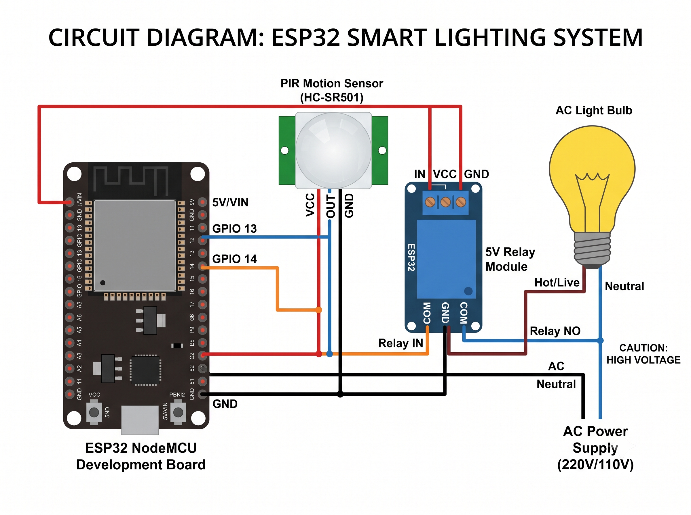
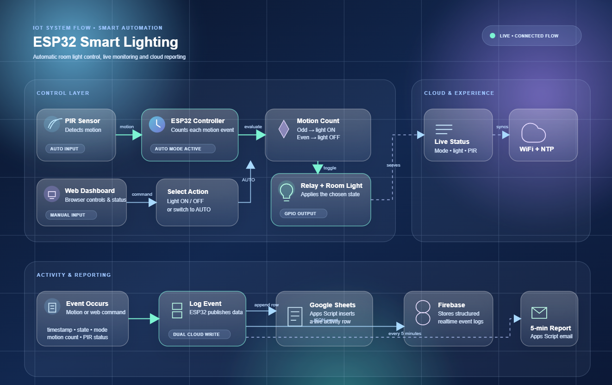
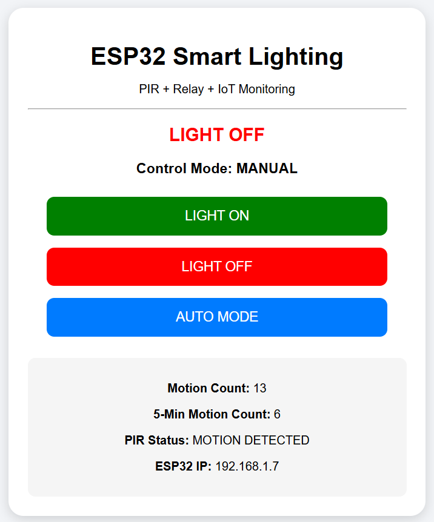
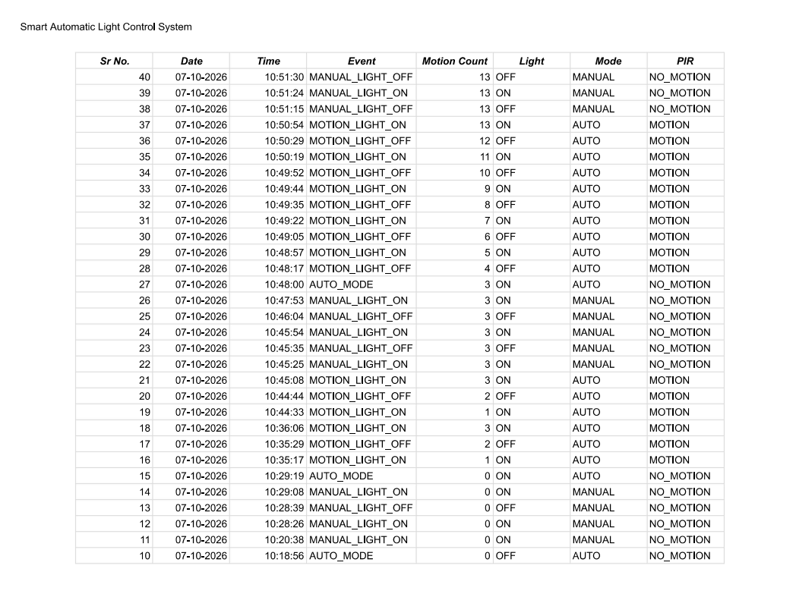
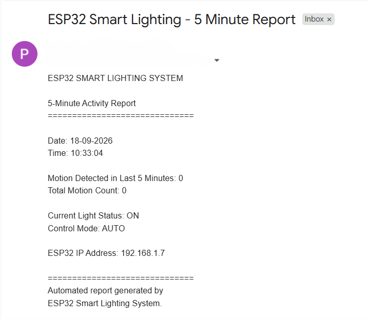

# ESP32 Smart Lighting System

An IoT-based smart lighting system using ESP32, PIR motion sensing,
relay-based light control, web-based manual control, Firebase,
Google Sheets logging, and automated email reporting.

## Features

- Automatic light control using PIR motion sensor
- ESP32-based control
- Relay-based AC light switching
- Manual ON/OFF control through web dashboard
- Automatic mode
- Motion counting
- Real-time event logging
- Firebase integration
- Google Sheets integration
- 5-minute activity email reports
- Web-based monitoring dashboard
- Timestamped event records

## Hardware Components

- ESP32 NodeMCU Development Board
- HC-SR501 PIR Motion Sensor
- 5V Relay Module
- AC Light Bulb
- Bulb Holder
- Breadboard
- Jumper Wires
- AC Power Supply

## Software & Technologies

- Arduino IDE
- Embedded C/C++
- ESP32
- Wi-Fi
- HTTP
- Firebase
- Google Apps Script
- Google Sheets
- HTML/CSS
- Web Server

## System Architecture

PIR Sensor
     ↓
ESP32 Controller
     ↓
Motion Processing
     ↓
Relay
     ↓
AC Light

ESP32
 ├── Web Dashboard
 ├── Firebase
 ├── Google Sheets
 └── Email Reporting

## Operating Modes

### AUTO Mode

The PIR sensor detects motion and the ESP32 controls the
light automatically.

### MANUAL Mode

The user can control the light through the web dashboard.

## Cloud Monitoring

The system records:

- Date
- Time
- Event
- Motion Count
- Light Status
- Control Mode
- PIR Status

## Project Demonstration

### Circuit Diagram



### System Flowchart



### Web Dashboard



### Google Sheets Logging



### Email Report



## Project Structure

```text
ESP32-Smart-Lighting-System/
│
├── src/
│   └── automatic_room_light_control_system_final.ino
│
├── cloud/
│   └── google_sheet_app_script_code.txt
│
├── docs/
│   ├── circuit_diagram.png
│   ├── flow_chart.png
│   ├── web_server_dashboard.png
│   ├── realtime_logged_data_google_sheet.png
│   └── five_minutes_report_mail.png
│
├── README.md
└── .gitignore